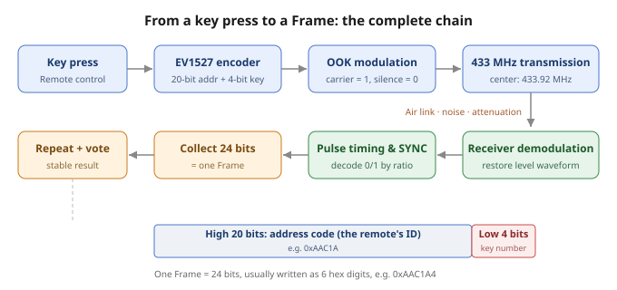
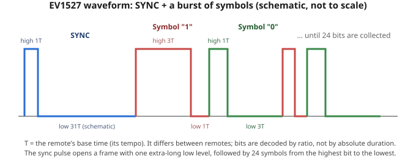
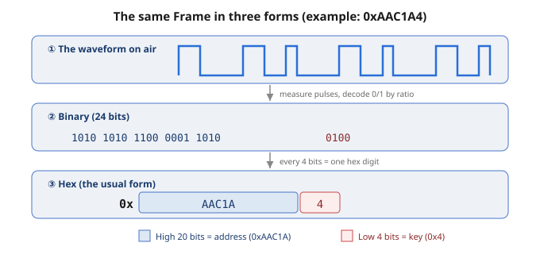

# What Is an EV1527 Frame: From a Key Press to a Frame of Data

English | [简体中文](README.zh-CN.md)

**Scope**: This article covers the RFX1 (433 MHz OOK EV1527) wireless receiver module from nulllab and is written for anyone who wants to understand what a "433 remote control" is actually transmitting. It does not depend on any development platform or programming language.

**Frame in one sentence**: A Frame is the digital encoding of one key press on a remote control — a 24-bit binary number whose upper 20 bits identify the remote (its ID — the address code) and whose lower 4 bits say which key was pressed (the key value). It usually appears as a 6-digit hexadecimal number, such as `0xAAC1A4`. One key press sends the same frame repeatedly; the receiver module votes over the received frames and outputs a stable result.

Unless stated otherwise, *Frame* below always means the 24-bit radio-frequency frame (RF Frame) defined by the EV1527 protocol. If you only want the answer, this is it.

**About RFX1**: it performs the most complex parts of wireless remote reception — RF reception, SYNC search, pulse-width measurement, bit-by-bit decoding, and multi-frame voting/filtering — entirely inside the module. You do not need to care about any low-level reception details: read the Frame over I2C, get "which remote pressed which key", and start writing your application logic right away. This article explains the principles so that you know what the module has already done for you — and so you don't have to do it yourself.

---

## Contents

1. [What the whole chain looks like](#1-what-the-whole-chain-looks-like)
2. [433 MHz: a shared channel](#2-433-mhz-a-shared-channel)
3. [OOK: the simplest way to signal](#3-ook-the-simplest-way-to-signal)
4. [EV1527: packing 24 bits into on/off pulses](#4-ev1527-packing-24-bits-into-onoff-pulses)
5. [Three faces of a Frame](#5-three-faces-of-a-frame)
6. [Why one key press yields several frames](#6-why-one-key-press-yields-several-frames)
7. [Common misconceptions](#7-common-misconceptions)
8. [Glossary](#8-glossary)
9. [FAQ](#9-faq)

---

## 1. What the whole chain looks like

From the moment you press a key to the moment the module outputs a Frame, only seven steps are involved:

Read the diagram in order: blue (the remote control side) → the over-the-air link in between → green (the receiver module side) → orange (the Frame that finally comes out). Each step is explained in a later section.

One easily overlooked fact: **the wireless link is one-way**. The remote does not know whether the receiver heard it, and the receiver does not know whether what it heard was correct — this is why the "repeat + vote" mechanism (section 6) matters so much.

## 2. 433 MHz: a shared channel

433 MHz is a **license-free public band** (an ISM band — industrial, scientific and medical). In plain terms: no license is needed, and anyone may transmit in this band, as long as transmit power stays low and transmissions do not interfere with other users.

The commonly used center frequency in this band is **433.92 MHz**. Product descriptions may say 433 MHz, 433.92 MHz, or even mislabel it as 443 MHz — they all refer to the same thing: the **433 MHz band**.

Because it is license-free, this "public channel" is crowded: remote switches, door sensors, tire-pressure monitors, weather stations… Your receiver may hear other people's remotes, and their receivers may hear yours. Keep this in mind — it explains why the address code matters (section 4).

**Note**: some remotes use the 315 MHz band instead (common in certain regional versions). A different band means the module cannot hear them at all — make sure to get 433 MHz hardware.

## 3. OOK: the simplest way to signal

What travels between the remote and the receiver is not "speech" but a sequence of on/off states. This modulation scheme is called **OOK (On-Off Keying)**, the simplest member of the ASK (Amplitude Shift Keying) family:

- **Transmitting**: to send a "1", turn the 433 MHz carrier on for a short while; to send a "0", turn it off;
- **Receiving**: the receiver turns this back into a simple high/low signal — carrier present = high level, carrier absent = low level.

Think of signaling with a flashlight: flash for 1, dark for 0. It is simple, power-efficient and cheap, which is exactly why 433 remote solutions are everywhere. The trade-off is limited noise immunity — any strong signal in the band can flip a "dark" into a "flash".

The decoded waveform looks like this (it is also the protagonist of section 4):

## 4. EV1527: packing 24 bits into on/off pulses

**EV1527** is a widely used fixed-code encoding protocol (compatible chips include the RT1527/FP1527/SC1527 family — see the FAQ). It defines how to pack 24 bits into the on/off waveform above. Three facts are enough to understand it:

### 4.1 Frame layout: 20 + 4

Every frame is exactly 24 bits, from the most significant bit to the least:

| Part | Bits | Meaning | Example |
|---|---|---|---|
| Address code | Upper 20 bits | The remote's ID, generated randomly at the factory, unique per remote | `0xAAC1A` |
| Key value | Lower 4 bits | Which key was pressed (A/B/C/D or 1/2/3/4) | `0x4` |

So the example Frame `0xAAC1A4` means: **"the remote whose ID is 0xAAC1A pressed key number 4."**

To decide "is this my remote?", the receiver compares the 20 address bits; to decide "which key maps to which action?", it looks at the 4 key bits. How to compare and how to map is entirely up to the receiver's program — the Frame simply delivers these two facts.

### 4.2 SYNC: the whistle that opens a frame

How does the receiver know where a frame starts? From the waveform: every frame begins with a **SYNC** — one extra-long low level (typically 31 times the base pulse width, see the figure). No normal symbol contains such a long "silence", so it is an unambiguous start marker. Upon seeing it, the receiver starts counting bits: after 24 of them, one frame has arrived.

### 4.3 Base time: the remote's tempo

Each symbol consists of one high and one low level, timed against the **base pulse width** (one time unit T):

- Symbol **"0"** = high 1T + low 3T
- Symbol **"1"** = high 3T + low 1T
- SYNC = high 1T + low 31T

The key point: **T differs between remotes** (typically somewhere between a few hundred microseconds and a few milliseconds). The receiver does not rely on absolute durations but on **ratios** — "the high level is much longer than the low level" means 1, and the other way round means 0. This is why remotes with different speeds can all be decoded by the same module.

## 5. Three faces of a Frame

The same Frame exists in different forms at different stages. With this figure, the string of digits you see in a serial log is no longer gibberish:

Three conventions, followed consistently across all nulllab documentation:

1. **Hexadecimal notation**: 6 digits, uppercase, with the `0x` prefix, e.g. `0xAAC1A4`;
2. **Leading zeros matter**: `0x01A2B4` and `0x1A2B4` are the same frame. Serial output may drop leading zeros when the address is small — be careful with string comparisons;
3. **Layered meaning**: the address code says "who sent it", the key value says "what was pressed". Two remotes can share the same key value but never (normally) the same address, which is how the receiver tells them apart.

## 6. Why one key press yields several frames

This is the most frequently asked beginner question, and the answer is: **it is a feature, not a bug.**

Recall the fact from section 1: the wireless link is one-way and unreliable. While a 24-bit frame travels through the air, any part of it can be corrupted by noise. Sending it only once would be gambling. So EV1527 does something very direct — **one key press transmits the same frame many times** (and keeps repeating as long as the key is held).

The receiver's design problem then becomes: **"I heard N frames, some of them damaged by noise — which one should I trust?"**

The common answer is **voting**: within a time window, group the received frames by content and count each group; only the most frequent group — and only if it reached a minimum count — is accepted; otherwise the whole window is discarded. It is the same logic as "three people repeat the same sentence, two say the same thing, so trust the majority".

This also explains two phenomena you may observe:

- **One key press prints several identical Frames** — normal: those are retransmissions of the same frame, and the module deduplicates them by voting (if filtering is enabled);
- **Occasionally a "strange" Frame shows up** — it may be a neighbor's remote bleeding into the band (remember section 2?), or a frame that made it through with some bits corrupted. The window-voting mechanism exists precisely to keep such "one-off frames" out.

**Be realistic about accuracy: reception and decoding results are not 100% correct.** The wireless link is unreliable by nature; signal quality, environmental interference, distance and obstacles, co-band devices, and the inherent limits of the protocol and the decoding mechanism can all cause lost frames, bit errors, or in extreme cases misjudgments. Window voting greatly reduces these risks but cannot eliminate them. Verify thoroughly in the real deployment environment when designing your application logic; for reliability-critical applications, keep human review or other supporting checks in the loop, and never treat a single received frame as the sole source of truth.

**"Raw" vs "filtered" frames**: some receiver modules provide both results — raw frames (whatever was heard, good for debugging and code sniffing) and filtered frames (the stable voting result, good for application logic). Which one to use depends on whether you want to "see everything" or "get a trustworthy answer". For the specific API, refer to the module's documentation.

## 7. Common misconceptions

| # | Misconception | Fact |
|---|---|---|
| 1 | "My remote is 443 MHz" | The band is **433 MHz** (center frequency 433.92 MHz); "443" is a widespread typo |
| 2 | "A Frame is a command" | A Frame only reports "which remote pressed which key"; what it triggers is decided by the receiver's program |
| 3 | "Receiving one frame is reliable" | A single frame can be corrupted in the air. Reliability comes from **repeat + voting**, not from any single frame |
| 4 | "EV1527 is encrypted and secure" | EV1527 is a **fixed-code, plaintext** protocol; any receiver in the band sees the same Frame. For anti-replay and anti-cloning, choose rolling-code schemes |
| 5 | "OOK, EV1527 and 433 MHz are the same thing" | They live on different layers: **OOK is the modulation** (how on/off represents bits), **EV1527 is the encoding protocol** (how 24 bits become an on/off sequence), **433 MHz is the band** (where the signal travels) |
| 6 | "The module's data rate is the remote's speed" | The module's RF profile rate (e.g. 2.4–40 kbps) is a property of the module's own link; the remote's EV1527 speed is set by its own base pulse width. The two are independent |
| 7 | "Two remotes produced the same Frame — something is broken" | The 20-bit address space is large but finite, so collisions are possible. They are rare but normal, and can be handled by address comparison logic |
| 8 | "The printed frame is missing digits — data was lost" | Check for dropped leading zeros first: `0x1A2B4` and `0x01A2B4` are the same frame |

## 8. Glossary

| Term | Explanation |
|---|---|
| Frame | The digital encoding of one key press — the 24-bit radio-frequency frame (RF Frame) defined by the EV1527 protocol |
| Address code | The upper 20 bits of a frame — the remote's ID (C0–C19 in the official datasheet) |
| Key value | The lower 4 bits of a frame — which key was pressed (also called key data or button code) |
| SYNC / Preamble | One extra-long low level that opens every frame ("a frame starts here"). The official datasheet calls it the preamble, defined as high 1T + low 31T |
| Base time (T) | The remote's tempo unit T; it differs between remotes, and bits are decoded by ratio (also called pulse width) |
| OOK | On-Off Keying — modulation scheme: carrier on = 1, carrier off = 0; the simplest form of ASK |
| ASK | Amplitude Shift Keying — modulation by amplitude changes; OOK is its special case |
| 433 MHz band | License-free public band; commonly used center frequency is 433.92 MHz |
| ISM band | License-free band for industrial/scientific/medical use; 433 MHz belongs to it |
| Fixed code | Encoding whose address is fixed at production and sent in plaintext (EV1527 belongs to this class) |
| Burst | One key press transmits the same frame many times (repeat transmission), to compensate for the unreliable wireless link |
| Voting filter | Window filter — within a time window, frames are grouped and counted; the majority group wins if it reaches the threshold |

**Writing conventions** (consistent across all nulllab documentation): frequencies are written as "433 MHz band (center frequency 433.92 MHz)", shortened to "433 MHz" afterwards; frames are written as 6 uppercase hexadecimal digits with the `0x` prefix; "Frame" is defined on first use and used alone afterwards.

## 9. FAQ

**Q1: How do I know whether my remote is EV1527?**
Check the product manual or the label on the remote; or open it and look at the encoder chip marking — EV1527 and its compatible family (RT1527, FP1527, SC1527, etc.) share exactly the same frame format, so frames from either side are mutually intelligible. Note that PT2262/PT2272 is a different tri-state address protocol with a different frame format and is not EV1527-compatible. Most "fixed-code 433 remotes" are EV1527-compatible. The most direct verification: pair a receiver module, press a few keys, and if 24-bit frames arrive consistently, you are set.

**Q2: Will two remotes interfere with each other?**
Normally no. Their address codes differ, and the receiver tells "who is talking" by comparing address codes. But on the license-free 433 MHz band, someone else's remote can in theory be heard by your module (section 2), so always compare the address code in your application logic before acting on the key value.

**Q3: Can I create a Frame myself?**
Protocol-wise, absolutely — you can pick any 20-bit address and any 4-bit key value you like. Use another transmitter module and encode the same way. But note this also means anyone can forge frames that look like yours (see Q4) — do not rely on fixed codes for security-sensitive applications.

**Q4: Is this scheme secure?**
Fixed-code protocols are plaintext and replayable: record your Frame, replay it, and it works again. For security-sensitive applications such as garage doors and access control, choose rolling-code schemes with anti-replay mechanisms. EV1527 as described here suits non-security remote-control use such as light switches and toys.

**Q5: Is holding a key different from tapping it?**
Yes. A tap sends a finite burst; holding keeps transmitting continuously. For the voting filter more samples mean a more stable result, but holding also produces consecutive batches of results — your application logic should distinguish "one long press" from "multiple taps".

---

**Tip**: if anything in this article is unclear, just ask an AI assistant — for example, paste the relevant paragraph into a conversational AI and ask it to explain it differently, or to relate it to your own use case. Treat AI explanations as a reference for understanding; for concrete parameters and operations, rely on this article and the module's official documentation.

---

*This article is part of the nulllab wiki basics series, written to help readers understand the concepts on their own. For module-specific usage and parameters, refer to the corresponding product documentation.*
