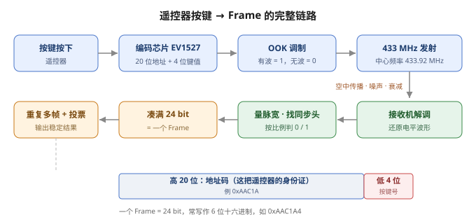
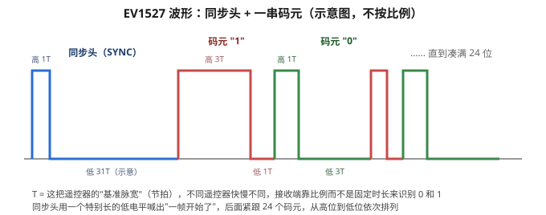
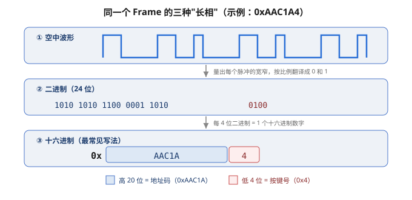

# EV1527 Frame 是什么：从遥控器按键到一帧数据

[English](README.md) | 简体中文

**适用范围**：本文适用于 nulllab（空想实验室）系列的 RFX1（433 MHz OOK EV1527）无线接收模块，也适合任何想弄懂"433 遥控器到底在发什么"的读者。不依赖任何开发平台或编程语言。

**一句话说清 Frame**：Frame（帧）是遥控器一次按键内容的数字编码——一个 24 位的二进制数，前 20 位是这把遥控器的"身份证"（地址码），后 4 位说明按的是哪个键（键值），通常写作 6 位十六进制，如 `0xAAC1A4`。按一次键，遥控器会连发多帧相同内容，接收模块将收到的多帧"投票"过滤后输出稳定结果。

**关于 RFX1**：它把无线遥控接收中最复杂的部分——射频信号接收、同步头搜索、脉宽测量、逐位解码、多帧投票滤波——全部在模块内部完成。你无需关心任何底层接收细节，通过 I2C 读取 Frame，拿到"哪把遥控器按了哪个键"的结果，即可直接开始业务逻辑开发。本文讲解原理，正是为了让读者知道"模块已经替你做了什么"，而无需亲手再做一遍。

下文如无特别说明，Frame 均指 EV1527 协议定义的 24 位无线射频帧（RF Frame）。如果你只想知道答案，读到这里就够了。

---

## 目录

1. [整条链路长什么样](#1-整条链路长什么样)
2. [433 MHz：一个公共频道](#2-433-mhz一个公共频道)
3. [OOK：最简单的发声方式](#3-ook最简单的发声方式)
4. [EV1527：把 24 bit 塞进亮灭序列](#4-ev1527把-24-bit-塞进亮灭序列)
5. [Frame 的三种"长相"](#5-frame-的三种长相)
6. [为什么按一次键会收到好几帧](#6-为什么按一次键会收到好几帧)
7. [常见误区](#7-常见误区)
8. [术语速查表](#8-术语速查表)
9. [FAQ](#9-faq)

---

## 1. 整条链路长什么样

从你按下按键到模块输出一个 Frame，中间发生的事情其实只有七步：

读图的顺序是：蓝色（遥控器一侧）→ 中间的空中传播 → 绿色（接收模块一侧）→ 橙色（最终输出的 Frame）。每一步在后面的章节里都会展开。

一个容易忽略的事实：**无线链路是单向的**。遥控器不知道接收模块有没有听到，接收模块也不知道自己听到的内容对不对——所以"多帧重复 + 投票"这套机制（第 6 节）才如此重要。

---

## 2. 433 MHz：一个公共频道

433 MHz 是一个**免许可的公共频段**（ISM 频段，industrial / scientific / medical，工业、科学、医疗用途）。意思是：不需要牌照，人人都可以在这个频段发射无线信号——只要功率不大、不干扰别人。

这个频段的常用中心频率是 **433.92 MHz**。你会在各种产品说明里看到 433 MHz、433.92 MHz 甚至被误写成 443 MHz 的字样，它们指的都是同一个东西：**433 MHz 频段**。

正因为它免许可，这个"公共频道"上挤满了各种设备：遥控开关、门磁、胎压监测、气象站……你的接收模块随时可能听到别人的遥控器在"喊话"，别人的模块也可能听到你的遥控器。这是理解后面"地址码为什么重要"的关键背景。

**注意**：市场上还存在 315 MHz 频段的遥控器（多见于某些地区版本）。频段不同，模块收不到，购买时请认准 433 MHz。

---

## 3. OOK：最简单的发声方式

遥控器和接收模块之间传的不是"话"，而是一串亮灭信号。这种调制方式叫 **OOK（On-Off Keying，通断键控）**，属于 ASK（幅移键控）家族里最简单的一种：

- **发射**：要传"1"，就把 433 MHz 的无线载波打开一小段；要传"0"，就关掉一小段。
- **接收**：接收机把这段波形还原成一根电平线——有波 = 高电平，没波 = 低电平。

可以把它想象成用手电筒打摩斯密码：亮一下是 1，灭一下是 0。它简单、省电、便宜，这正是 433 遥控方案遍布全世界的原因。代价是抗干扰能力一般——任何同频段的强信号都可能把"灭"误判成"亮"。

下面这张图就是解码后的波形样子（也是第 4 节的主角）：

---

## 4. EV1527：把 24 bit 塞进亮灭序列

**EV1527** 是一种广泛使用的固定码编码协议（对应 PT2262/SC1527 等兼容芯片），它规定了如何把 24 bit 的内容编成上面那种亮灭波形。理解它只需要三个知识点：

### 4.1 帧结构：20 + 4

每一帧固定 24 位，从高位到低位：

| 部分 | 位数 | 含义 | 举例 |
| --- | --- | --- | --- |
| 地址码 | 高 20 位 | 这把遥控器的"身份证"，出厂时随机生成，每把遥控器不同 | `0xAAC1A` |
| 键值 | 低 4 位 | 按的是哪个键（A/B/C/D 或 1/2/3/4） | `0x4` |

所以示例 Frame `0xAAC1A4` 的完整含义是：**"身份证号为 0xAAC1A 的那把遥控器，按下了 4 号键。"**

接收端要识别"是不是我的遥控器"，比对的就是这 20 位地址码；要执行"哪个键对应哪个动作"，看的就是这 4 位键值。怎么比对、怎么对应，由接收端的程序自己决定——Frame 本身只负责把这两件事如实送达。

### 4.2 同步头：一帧开始的"哨声"

接收端怎么知道一帧从哪里开始？答案在波形图里：每帧开头有一个**同步头（SYNC）**——一个特别长的低电平（典型为基准脉宽的 31 倍，见图 2）。正常码元里不可能出现这么长的"灭"，所以它是一个无歧义的起始标记。看到它，接收端就开始逐位计数：收满 24 位，一帧到手。

### 4.3 基准脉宽：这把遥控器的"节拍"

每个码元由一高一低两段电平组成，长短都以**基准脉宽**（一个时间单位 T）为节拍：

- 码元 **"0"** = 高 1T + 低 3T
- 码元 **"1"** = 高 3T + 低 1T
- 同步头 = 高 1T + 低 31T

关键在于：**不同遥控器的 T 不一样**（常见的从一百多微秒到几毫秒不等）。接收端不依赖绝对时长，而是看**比例**——"高电平比低电平长得多"就是 1，反过来就是 0。这就是为什么快慢不同的遥控器都能被同一个模块正确解码。

---

## 5. Frame 的三种"长相"

同一个 Frame，在不同环节以不同形式存在。对上这张图，你在串口/日志里看到的那串数字就不再是天书：

三个关键约定，nulllab 全系文档统一遵循：

1. **十六进制书写**：6 位、大写、带 `0x` 前缀，如 `0xAAC1A4`。
2. **前导零要补齐**：`0x01A2B4` 和 `0x1A2B4` 是同一个帧。地址码低位较小时，程序打印可能省略前导零，做字符串比较时要小心。
3. **帧的含义分层**：地址码决定"这是谁"，键值决定"按了什么"。两把遥控器可以按出相同的键值，但地址码不同，接收端就能区分它们。

---

## 6. 为什么按一次键会收到好几帧

这是新手提问率最高的问题，答案是：**这是特性，不是故障。**

回忆第 1 节的事实：无线链路是单向的、不可靠的。一帧 24 bit 在空中飞行时，任何一段都可能被噪声破坏。如果只发一帧，收到就是赌运气。所以 EV1527 的做法很直接——**按一次键，把同一帧连发很多遍**（按键按住期间更是持续重发）。

于是接收端的设计问题变成了：**"我听到了 N 帧，其中有几帧被噪声打坏了，我该信哪一帧？"**

主流的做法是**投票**：在一个时间窗口内，把收到的帧按内容分组、统计出现次数，出现得最多、且达到足够次数的那组才算数；凑不够数的窗口整体作废。这和"三个人报同一句话、两个人说的是一样的，就听多数人的"是一个道理。

这也解释了你在使用接收模块时可能遇到的两类现象：

- **按一下键，打印出好几个相同的 Frame** —— 正常，那是同一帧的多次重发，模块帮你做了投票去重（如果开启了滤波）。
- **偶尔收到一个"莫名奇妙"的 Frame** —— 可能是邻居的遥控器串台（还记得第 2 节吗？公共频道），也可能是一帧被噪声打坏后仍被当成了正常帧。窗口投票机制存在的意义，就是把这类"个别帧"挡在外面。

**需要客观看待的是：接收与解码结果并非 100% 准确。** 无线链路本身不可靠，信号质量、环境干扰、距离与遮挡、同频段设备冲突，以及编码协议与解码机制的固有局限，都可能导致漏帧、误码，极端情况下甚至出现误判。窗口投票等机制能大幅降低这些风险，但不能完全消除。建议在业务逻辑设计时结合实际部署环境进行充分核验；对可靠性要求较高的场景，应保留人工复核或其他辅助判断手段，不要把单次接收结果当作唯一依据。

**"原始帧"和"滤波后帧"**：一些接收模块会同时提供两种结果——原始帧（听到什么给什么，适合调试和抓码）和滤波后帧（投票后的稳定结果，适合业务逻辑）。用哪个，取决于你要的是"看见全过程"还是"要一个可信答案"。具体接口请查阅对应模块的文档。

---

## 7. 常见误区

| # | 误区 | 事实 |
| --- | --- | --- |
| 1 | "我的遥控器是 443 MHz 的" | 频段是 **433 MHz**（中心频率 433.92 MHz），"443"是流传甚广的笔误 |
| 2 | "Frame 是一条命令" | Frame 只是"哪把遥控器按了哪个键"的报告；如何解释、触发什么动作，由接收端程序决定 |
| 3 | "收到一帧就可靠了" | 单帧可能在空中被打坏。可靠性来自**多帧重发 + 投票**，不来自单帧本身 |
| 4 | "EV1527 是加密的，很安全" | EV1527 是**固定码、明文**协议，任何同频接收机都能看到同样的 Frame。需要防重放、防复制请选用滚动码等方案 |
| 5 | "OOK、EV1527、433 MHz 是一回事" | 三个不同层面：**OOK 是调制方式**（怎么用亮灭表示信号）、**EV1527 是编码协议**（怎么把 24 bit 编成亮灭序列）、**433 MHz 是频段**（信号在哪个频率上跑） |
| 6 | "模块的传输速率就是遥控器的速度" | 模块的 RF 速率档位（如 2.4~40 kbps）是模块自身收发链路的参数；遥控器 EV1527 的快慢由它自己的基准脉宽决定，两者是独立的 |
| 7 | "两把遥控器发出了相同的 Frame，肯定坏了" | 20 位地址码的空间虽大但有限，确实可能撞码。碰撞概率低但存在，属正常现象，可通过地址比对逻辑规避 |
| 8 | "打印出来的帧少了几位，数据丢了" | 先检查是不是前导零被省略：`0x1A2B4` 和 `0x01A2B4` 是同一个帧 |

---

## 8. 术语速查表

| 术语 | 英文 | 白话解释 |
| --- | --- | --- |
| 帧（Frame） | Frame | 遥控器一次按键内容的数字编码——EV1527 协议下的 24 位无线射频帧（RF Frame） |
| 地址码 | Address code | 帧的高 20 位，遥控器的"身份证" |
| 键值 | Key data / Button code | 帧的低 4 位，按下的是哪个键 |
| 同步头 | SYNC / Sync pulse / Preamble | 每帧开头一段超长低电平，标记"一帧开始"。官方数据手册中称为前导码（Preamble），定义同为高 1T、低 31T |
| 基准脉宽 | Base time / Pulse width | 遥控器发码的节拍单位 T，不同遥控器不同；接收端靠比例识别 0/1 |
| 通断键控 | OOK (On-Off Keying) | 调制方式：有波 = 1，无波 = 0；ASK 的最简形式 |
| 幅移键控 | ASK (Amplitude Shift Keying) | 用幅度变化表示数据的调制方式，OOK 是其特例 |
| 433 MHz 频段 | 433 MHz band | 免许可公共频段，常用中心频率 433.92 MHz |
| ISM 频段 | ISM band | 工业/科学/医疗用途的免许可频段，433 MHz 属于其中 |
| 固定码 | Fixed code | 地址码出厂固定、明文发送的编码方式（EV1527 属此类） |
| 连发 | Repeat / Burst | 按一次键发射多帧相同内容，对抗无线链路不可靠 |
| 投票滤波 | Window filter / Voting | 时间窗口内按内容分组计数，多数且达标者胜出 |

**书写约定**（nulllab 全系文档统一）：频率一律写"433 MHz 频段（中心频率 433.92 MHz）"，首次出现后可简写"433 MHz"；帧统一写 6 位大写十六进制、带 `0x` 前缀；"帧（Frame）"首次中英对照，之后可单用。

---

## 9. FAQ

**Q1：我怎么知道手里的遥控器是不是 EV1527？**
先看产品说明书或遥控器外壳标注；也可以拆开看编码芯片丝印——EV1527 及其兼容系列（RT1527、FP1527、SC1527 等）采用完全相同的帧格式，任意一方发出的帧另一方都能收发。注意 PT2262/PT2272 是另一套三态地址协议，帧格式不同，不与 EV1527 兼容。市场上绝大多数"固定码 433 遥控器"都是 EV1527 兼容的。最直接的验证方法：配一个接收模块按几次键，如果稳定收到 24 位的帧，基本可以确认。

**Q2：两把遥控器会互相干扰吗？**
正常不会。地址码不同，接收端靠比对地址码区分"是谁在说话"。但在免许可的 433 MHz 公共频道上，**别人家的**遥控器理论上也可能被你的模块听到（第 2 节），所以业务逻辑里务必先比对地址码，再处理键值。

**Q3：我能自己造一个 Frame 吗？**
协议上完全可以——20 位地址 + 4 位键值是任意组合。用另一块发射模块按同样的编码规则发帧即可。但请注意：这也意味着任何人都能伪造你的遥控器的帧（见 Q4），安全敏感场景请勿依赖固定码。

**Q4：这个方案安全吗？**
固定码协议是明文的、可重放的：录下你的 Frame，就能原样重发。对于车库门、门禁等安全敏感场景，请选用滚动码（rolling code）等具备防重放机制的方案。本文介绍的 EV1527 适合不设防的遥控场景，如灯光开关、玩具等。

**Q5：按住不放和点按一下，收到的帧数量一样吗？**
不一样。点按是有限次数的连发；按住期间遥控器会持续重发。对投票滤波来说，样本越多结果越稳，但也意味着按住不放会产生连续多批结果，业务逻辑上要考虑"一次长按"和"多次点按"的区分。

---

**小提示**：阅读中遇到不理解的地方，可以直接询问 AI 助手——比如把相关段落贴给对话式 AI，请它换一种方式解释，或结合你的使用场景举例说明。AI 的解释可作为理解参考，涉及具体参数与操作时，仍以本文及对应模块的官方文档为准。

---

*本文属于 nulllab wiki 基础概念系列，旨在帮助读者自助理解相关概念。模块的具体用法与参数，请以对应产品文档为准。*
